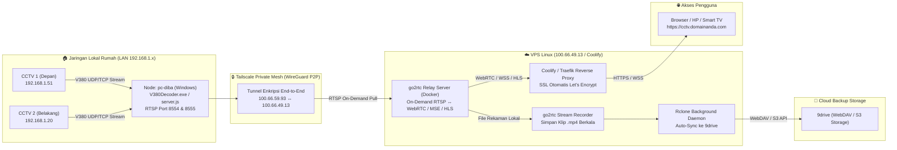

# 🎥 Cetak Biru Arsitektur: Cloud CCTV AI (PC Diba + VPS + Subdomain + 9drive)

Dokumen ini adalah rancangan arsitektur lengkap dan panduan teknis implementasi untuk mengonlinekan sistem CCTV lokal rumah menjadi sistem Cloud CCTV yang aman, hemat bandwidth, dapat diakses via subdomain publik, dan otomatis ter-backup ke 9drive.

---

## 1. Topologi Arsitektur Sistem



---

## 2. Bagian 1: Peran & Analisis Node `pc-diba` (Windows Home Edge)

*Node ID: `pc-diba` | IP Tailscale: `100.66.59.93` | IP LAN: `192.168.1.24`*

### A. Kebutuhan di Windows:
1. **Decoder Protokol V380 (Sudah Aktif di Mesin Diba)**:
   - Direktori kerja: `C:\Users\fanni\v380-web`
   - Port RTSP lokal:
     - **CCTV 1 (Depan)**: `rtsp://100.66.59.93:8554/live` (HTTP `8081`)
     - **CCTV 2 (Belakang)**: `rtsp://100.66.59.93:8555/live` (HTTP `8082`)
     - **Web Dashboard Lokal**: `http://100.66.59.93:3000`
2. **Windows Firewall Rule**:
   - Izinkan port `8554`, `8555`, dan `3000` **khusus pada antarmuka Tailscale** agar hanya VPS yang bisa mengakses stream.
3. **Background Persistence**:
   - Daftarkan `node server.js` atau `V380Decoder.exe` ke Task Scheduler Windows agar otomatis aktif di background saat PC Diba menyala.

### B. Metode Paling Efisien: PULL On-Demand (Bukan PUSH 24/7)
> [!IMPORTANT]
> **Jangan melakukan streaming 24 jam nonstop ke VPS!**
> Mengirim 2 stream video H.264 secara terus-menerus akan memakan bandwidth upload internet rumah sebesar 3–6 Mbps nonstop dan berpotensi membuat koneksi internet rumah tersendat.
- **Solusi**: Jadikan PC Diba sebagai **RTSP Server Pasif**.
- VPS (`go2rtc`) hanya akan menarik (*PULL*) stream dari PC Diba **saat ada pengguna yang membuka website**.
- Jika tidak ada yang menonton, penggunaan bandwidth internet rumah adalah **0 bps**.
- **Zero-Transcoding (Direct Passthrough)**: Jangan melakukan re-encoding video di PC Diba. Gunakan format passthrough H.264/AAC asli agar beban CPU PC Diba tetap di bawah 5%.

---

## 3. Bagian 2: Peran & Analisis Node `vps` (Cloud Server & Subdomain)

*Node ID: `vps` | IP Tailscale: `100.66.49.13` | Platform: Docker & Coolify*

### A. Penerima Stream (go2rtc di Docker):
Pasang kontainer ringan `go2rtc` di VPS dengan file konfigurasi `go2rtc.yaml`:

```yaml
streams:
  cctv_depan:
    - rtsp://100.66.59.93:8554/live
  cctv_belakang:
    - rtsp://100.66.59.93:8555/live

api:
  listen: ":1984"

webrtc:
  listen: ":8555"
```

### B. Pemasangan Subdomain Publik via Coolify / Traefik:
1. Buat A-Record di DNS (Cloudflare / domain Anda):
   - `cctv.domainanda.com` &rarr; IP Publik VPS
2. Di Coolify (atau Traefik):
   - Daftarkan aplikasi Docker `go2rtc`.
   - Domain: `https://cctv.domainanda.com`
   - Port target: `1984`
   - SSL/TLS otomatis dikelola oleh Traefik / Let's Encrypt.
3. **Hasil**: Anda bisa membuka `https://cctv.domainanda.com` dari HP di luar rumah, langsung menonton CCTV dengan latensi sangat rendah (<0.5 detik via WebRTC) dengan tampilan web yang elegan.

---

## 4. Bagian 3: Integrasi Backup Rekaman ke 9drive

### A. Mekanisme Perekaman:
1. `go2rtc` atau script FFmpeg di VPS dapat memotong rekaman video per 15 menit atau hanya saat mendeteksi gerakan (*motion detection*).
2. Format file: `.mp4` disimpan di folder VPS: `/data/cctv_records/`.

### B. Sinkronisasi Otomatis ke 9drive via Rclone:
VPS sudah memiliki Docker `rclone` terpasang. Konfigurasikan remote `9drive` via WebDAV atau S3 API:

```ini
[9drive]
type = webdav
url = https://webdav.9drive.com/ (atau endpoint API 9drive Anda)
vendor = other
user = USERNAME_9DRIVE
pass = PASSWORD_ENCRYPTED
```

Jalankan sinkronisasi otomatis menggunakan cron setiap jam:
```bash
rclone move /data/cctv_records/ 9drive:CCTV_Backup/ --min-age 15m --delete-empty-src-dirs
```
- Perintah ini memindahkan (*move*) file rekaman yang sudah selesai ke 9drive dan menghapusnya dari penyimpanan lokal VPS agar SSD VPS tidak pernah penuh.

---

## 5. Bagian 4: Rekomendasi Repositori Open Source

| Repositori | Kelebihan | Rekomendasi untuk Kasus Anda |
| :--- | :--- | :--- |
| **[go2rtc](https://github.com/AlexxIT/go2rtc)** | **Pilihan #1 Terbaik.** Sangat enteng (<20 MB RAM), mendukung RTSP to WebRTC/MSE/HLS, ada fitur On-Demand Pull bawaan. | **Sangat Direkomendasikan** untuk relay VPS. |
| **[MediaMTX](https://github.com/bluenviron/mediamtx)** | Media server lengkap (RTSP, RTMP, HLS, WebRTC), performa tinggi berbasis Go. | Pilihan alternatif jika butuh kontrol webhook lengkap. |
| **[Frigate NVR](https://github.com/blakeblackshear/frigate)** | NVR lengkap dengan AI Object Detection (deteksi orang, mobil, hewan). | Pasang jika ingin deteksi AI cerdas di VPS. |

---

## 6. Ringkasan Tindakan untuk Eksekusi

1. **Di PC Diba**: Pastikan servis V380 berjalan dan port `8554`/`8555` dapat diakses dari IP Tailscale VPS `100.66.49.13`.
2. **Di VPS**: Deploy kontainer `go2rtc` via Coolify, hubungkan stream ke `100.66.59.93`, dan pasang subdomain `cctv.domainanda.com`.
3. **Di Storage**: Setup Rclone remote untuk auto-sync rekaman ke 9drive.
